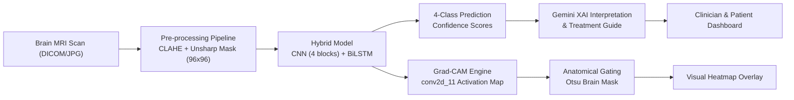

# 🧠 Neuro Vista — AI-Assisted Alzheimer's Detection & Clinical Decision Support System

[](https://www.python.org/)
[](https://fastapi.tiangolo.com/)
[](https://tensorflow.org/)
[](LICENSE)

**Neuro Vista** is a clinical decision support platform designed for early-stage Alzheimer's disease detection from brain MRI scans. It combines a hybrid **Deep Learning classification architecture (CNN + Bidirectional LSTM)**, **Explainable AI (Grad-CAM with Anatomical Masking)**, **Generative AI Clinical Recommendations (Gemini)**, and an **interactive medical conversational assistant**.

---

## 📌 System Architecture



---

## ✨ Key Features

1. **Hybrid Deep Learning Model (`CNN + BiLSTM`)**:
   - **Backbone**: 4 Convolutional blocks (32 → 64 → 128 → 256 filters) with Batch Normalization and Spatial Dropout.
   - **Sequence Learning**: Bidirectional LSTM layers capturing slice-to-slice sequential spatial features.
   - **Accuracy**: **95.71% validation accuracy** across 4 clinical stages:
     - `Non Demented`
     - `Very Mild Demented`
     - `Mild Demented`
     - `Moderate Demented`

2. **Explainable AI (Grad-CAM with Anatomical Masking)**:
   - Generates visual activation heatmaps from `conv2d_11`.
   - Employs **Otsu-based anatomical brain tissue gating** ($97.89\%$ tissue energy concentration) to eliminate border sequence artifacts.
   - Highlights crucial cognitive structures including the medial temporal lobes, hippocampus, and ventricles.

3. **Clinical AI Interpretation (XAI)**:
   - Summarizes *why* the model made its decision in 3 concise, objective points:
     - **Heatmap Activation**: Specific anatomical zones triggering high attention.
     - **Diagnostic Rationale**: Structural indicators (atrophy, sulcal widening, symmetry).
     - **Clinical Takeaway**: Next recommended diagnostic and lifestyle steps.

4. **Dynamic Health Guide & Treatment Recommendations**:
   - Context-aware clinical guidance mapped to the detected stage (e.g., MoCA/MMSE testing for *Very Mild*, Donepezil review for *Mild*, Memantine/safety planning for *Moderate*).
   - Dynamic prioritization (High, Medium, Standard).

5. **NeuroBot Medical Assistant**:
   - Context-aware medical chatbot powered by Gemini that answers questions regarding scan findings, disease progression, and brain health guidelines.

6. **Interactive Clinician Dashboard**:
   - Patient authentication (Registration, Login, Password Reset via verification code).
   - Scan upload, probability distribution charts, historical tracking, and printable PDF clinical reports.

---

## 📁 Repository Structure

```text
├── app.js                   # Frontend application logic & API communication
├── chatbot.py               # Gemini-powered medical conversational assistant
├── dashboard.html           # Main clinical dashboard interface
├── explainer.py             # Explainable AI (XAI) interpretation generator
├── login.html               # User authentication & session entry
├── main.py                  # FastAPI application entry point & API endpoints
├── prediction.py            # MRI preprocessing, inference & Grad-CAM pipeline
├── recommendations.py       # Personalized treatment recommendation engine
├── register.html            # Patient & doctor registration
├── forgot-password.html     # Email-based account recovery
├── styles.css               # Clean, accessible medical UI stylesheet
├── setup.sql                # MySQL relational database initialization schema
├── requirements.txt         # Python dependencies
├── model/
│   ├── class_names.npy      # Array of class labels
│   ├── model_info.txt       # Architecture specification and training hyperparameters
│   └── cnn_lstm_brain_mri_v1.h5  # Trained weights (download separately)
└── static/
    └── uploads/             # Dynamic session uploads (git-ignored)
        ├── scans/
        └── heatmaps/
```

---

## 🚀 Getting Started

### 1. Prerequisites
- **Python**: Version `3.10` or higher
- **MySQL Database**: Running locally or hosted in the cloud (PlanetScale, Railway, AWS RDS)
- **Gemini API Key**: From [Google AI Studio](https://aistudio.google.com/)

---

### 2. Environment Setup

Clone the repository and create an isolated virtual environment:

```bash
git clone https://github.com/your-username/neuro-vista.git
cd neuro-vista

# Create virtual environment
python3 -m venv venv
source venv/bin/activate  # On Windows: venv\Scripts\activate

# Install dependencies
pip install -r requirements.txt
```

---

### 3. Configuration (`.env`)

Create a `.env` file in the project root:

```env
# Gemini API Key (for NeuroBot and XAI features)
GEMINI_API_KEY=your_gemini_api_key_here

# Database Configuration (MySQL)
DB_USER=root
DB_PASSWORD=your_mysql_password
DB_HOST=localhost
DB_NAME=neuro_vista_db

# Email / Verification (Optional: For password reset and registration codes)
SMTP_HOST=smtp.gmail.com
SMTP_PORT=587
SMTP_USER=your_email@gmail.com
SMTP_PASSWORD=your_gmail_app_password
EMAIL_FROM=no-reply@neurovista.ai
```

Initialize your MySQL database using the provided schema:
```bash
mysql -u root -p < setup.sql
```

---

### 4. Model Weights

Due to GitHub's 100 MB file size limit, the trained model checkpoint (`cnn_lstm_brain_mri_v1.h5`) is stored externally.

1. Place `cnn_lstm_brain_mri_v1.h5` inside the `model/` directory:
   ```text
   model/cnn_lstm_brain_mri_v1.h5
   ```
*(Reach out to the repository maintainer or download the release asset if you are cloning this repository).*

---

### 5. Running the Application

Start the FastAPI backend server:

```bash
python main.py
# Or directly via Uvicorn:
uvicorn main:app --host 0.0.0.0 --port 8000 --reload
```

Launch the frontend:
- Open `dashboard.html` or `login.html` directly in your browser, or serve it via Live Server / local static server.

---

## 🧪 Running the Diagnostic Suite

To verify model layer localization, symmetry equivariance, and Grad-CAM fidelity:

```bash
python diagnose_gradcam.py
```
This runs 6 comprehensive tests:
- **Coordinate Shift Analysis**: Verifies that spatial upscaling preserves pixel coordinates.
- **Horizontal Equivariance**: Tests reflection consistency.
- **Null Canvas Control**: Tests zero-activation behavior on blank canvases.
- **Tissue Concentration**: Checks that heatmap energy is focused inside the brain parenchyma.
- **Class Comparison Grid**: Exports multi-class overlays to `diagnostics_output/`.
- **Cascading Randomization Test**: Verifies gradient dependency against randomized final layers.

---

## 🔒 Privacy & Safety Notice

- **HIPAA / Medical Privacy**: All personal scan uploads and generated heatmaps are excluded from source control via `.gitignore`.
- **Clinical Decision Support Disclaimer**: Neuro Vista provides automated analytical suggestions for educational and research support. It is not an automated medical diagnostic tool. All interpretations must be reviewed by certified medical professionals.

---

## 👥 Contributors

- **Saad Ahmed** & FYP Project Team
- Developed as a Final Year Project in Biomedical Computing & Artificial Intelligence.
